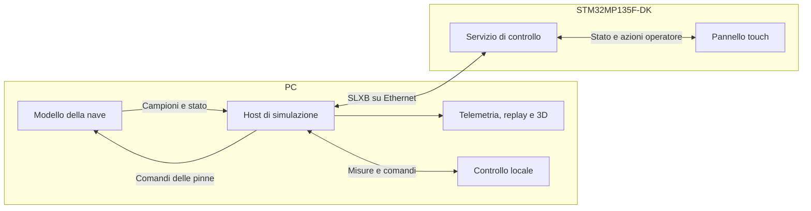

<!--
Silicon LogiX / SLX SeaBalance
Copyright (c) 2026 Marco Pezzullo (Silicon LogiX).
Author: Marco Pezzullo
License: Silicon LogiX Evaluation License 1.0. See LICENSE.
-->

# Architettura di SeaBalance

Il modello aggiorna il rollio, lo stato del mare, gli attuatori e le
misure della IMU virtuale. L'host usa queste misure come ingresso per il
controllo locale o per la centralina STM32MP135F-DK. La risposta del
controllore orienta le pinne virtuali al passo di simulazione successivo.
La telemetria conserva separatamente la posa calcolata, la stima della
centralina, il comando delle pinne e la posizione raggiunta.

## Moduli e interfacce

- Il programma PC carica il modello tramite l'ABI dichiarata nell'[header SDK](../sdk/include/slx/seabalance.h). Per il simulatore fornisci il binario per il tuo sistema con CMake `SLX_CORE_DIR`.
- Il PID di riferimento è disponibile in [examples/pid.cpp](../examples/pid.cpp). Il servizio e il programma PC possono usare la strategia SLX quando l'SDK di valutazione include il relativo binario.
- Il servizio e la GUI touch comunicano tramite lo stato locale del controllore. L'host scambia campioni e comandi con il servizio su [SLXB](PROTOCOLLO.md).

I due core proprietari sono componenti separati dell'SDK di valutazione.
Il servizio può essere compilato con il solo PID di riferimento e avviato
con `--pid-only`.

## Attuazione e supervisione

Il riferimento della nave usa X verso prua, Y verso babordo e Z verso
l'alto. Un rollio positivo solleva babordo. Gli angoli delle pinne sono in
radianti. Il controllore può orientare le pinne in versi opposti per produrre
una coppia attorno all'asse longitudinale. L'effetto varia con la velocità
nell'acqua, l'incidenza delle pinne e la loro immersione.

Il filtro complementare combina giroscopio e accelerometro. La supervisione
rileva misure mancanti o incoerenti e confronta il comando con il feedback
delle pinne. Durante un allarme il comando di stabilizzazione torna verso
il neutro. Il rientro richiede misure valide, pinne vicine al neutro e il
riconoscimento dell'operatore.

Dalla vista **Bilancio** il pannello può prendere o restituire il comando.
L'ultima revisione accettata arriva al PC con la telemetria. Dalla vista
**Manovra** il pannello modifica velocità e rotta della nave virtuale.
